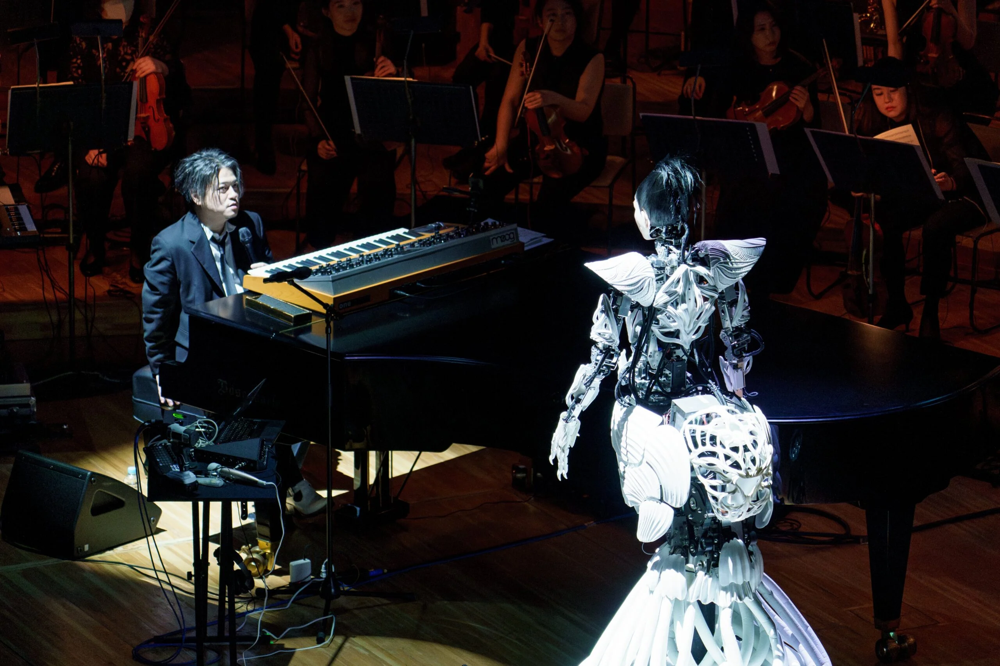

# ANDROID OPERA MIRROR ― Deconstruction and Rebirth ― 解体と再生

2025, [client work](client%20work--82200cd4d093785cb17be704505c73f9.md)

- Photo by Kenshu Shintsubo（写真：新津保建秀）©︎ATAK

## Overview
渋谷慶一郎の最新作『ANDROID OPERA MIRROR ― Deconstruction and Rebirth ― 解体と再生』が、2025年11月5日（水）にサントリーホールで上演され、約2時間にわたる公演の幕を閉じた。カーテンコールでは渋谷本人が感泣し、会場全体が大きなスタンディングオベーションに包まれた。
「アンドロイド・オペラ」は、アンドロイドが歌い、オーケストラ、ピアノ、電子音、映像、そして1200年の歴史を持つ仏教音楽・声明が融合する革新的なオペラ作品。人間とテクノロジー、東洋と西洋、伝統と革新、生と死といったあらゆる境界が侵蝕しあい、新たな調和のモデルと既存の枠組みの解体を無化することを提示している。これまでにドバイ万博、パリ・シャトレ座、東京で『MIRROR』を上演、今回新たに「解体と再生」バージョンでは作品の脱構築を通じて生と死の境界そのものを問い直し、人間とテクノロジーの関係に新たな希望と可能性を見出す試みとなった。
ステージには、渋谷の亡き妻をモデルとした「アンドロイド・マリア」が初登場、歌唱を披露。気鋭のヴァイオリニスト成田達輝をコンサートマスターに迎えた62名のスペシャルオーケストラ、藤原栄善を中心とした４人の高野山の僧侶による声明、電子音、リアルタイムでのAI会話など、異なる要素が有機的に融合するなかスペシャルゲストとして、グラミー受賞ベーシストのシャーロット・ケンプ・ミュール（Charlotte Kemp Muhl）も登場して、渋谷、アンドロイド・マリア、僧侶たちとのコラボレーションも披露した。

本作において、Visual ProgrammerとしてAI会話オペレーション・字幕映像制作を担当した。

## Credit
コンセプト、作曲
- 渋谷 慶一郎

＜アンドロイド・マリア＞
- アンドロイド・プログラミング: 今井慎太郎
- AI会話プログラミング: 岸裕真
- AI会話プログラミングアドバイザー: 池上高志
- AI会話オペレーション・字幕: 成瀬陽太
- アンドロイド制御システム: 松村礼央
- アンドロイド機構設計: 島谷直志
- アンドロイドフェイス製作: 右田淳
- スタイリングコンサルティング: Yaz
- アンドロイドヘア製作: Yuho Kamo、右田淳、高畑遥夏

[https://atak.jp/works/android-opera-mirror/](https://atak.jp/works/android-opera-mirror/)
