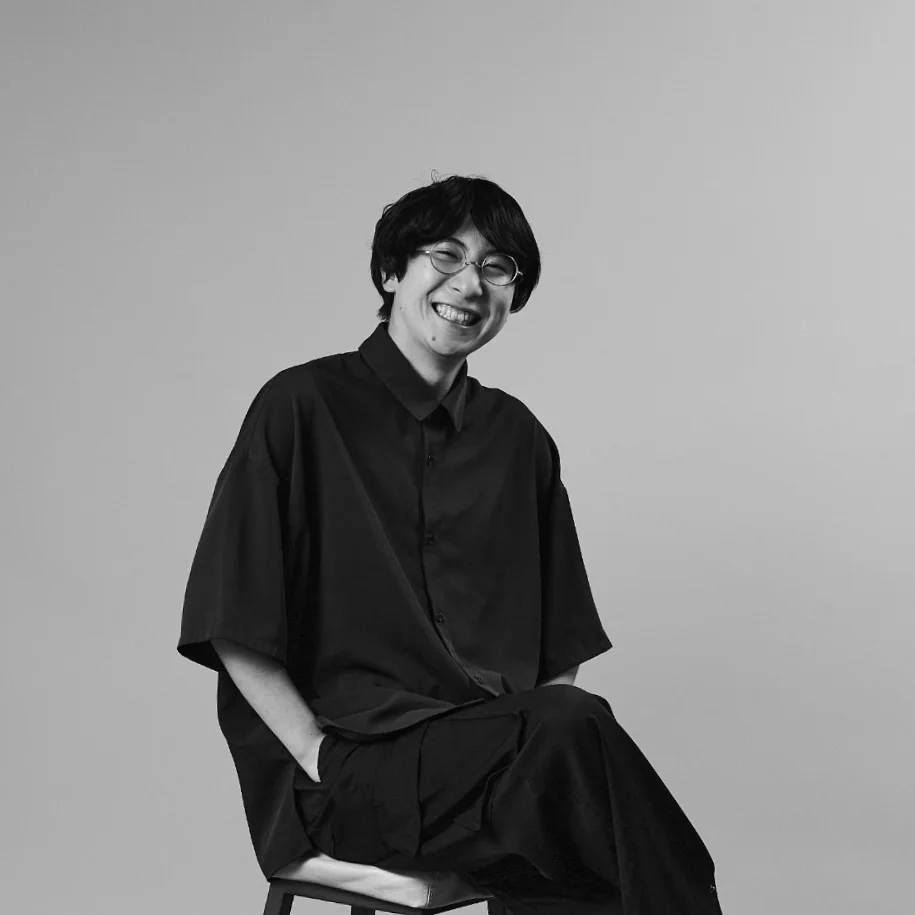

# About

## 成瀬 陽太 / Santa NARUSE 
アーティスト / 映像作家。
2000年生まれ。大阪府出身。2023年、慶應義塾大学環境情報学部卒業。2025年、情報科学芸術大学院大学(IAMAS) メディア表現専攻博士前期課程修了。
路上観察を行い、そこで発見した事象をインタラクションデザイン・認知科学の知見から再構築した装置やキネティック・アート作品を制作する。日常の中で見る視覚環境へ介入し、普段は見過ごされている事象を再発見させる視覚体験を探求する。
また、映像作家としてMUTEK.JPへの出演やライブイベントでの演出を手がけるほか、テクニカルアーティストとして他作家のプロジェクトにおけるシステム設計・実装も行うなど、多岐にわたり活動している。

Born in Osaka in 2000. Graduated from the Faculty of Environment and Information Studies at Keio University in 2023, and completed a Master's degree in Media Creation at the Institute of Advanced Media Arts and Sciences (IAMAS) in 2025.

Through street observation, the artist creates installations and kinetic artworks by reconstructing discovered phenomena using insights from interaction design and cognitive science. By intervening in the everyday visual environment, the work explores visual experiences that prompt the rediscovery of often-overlooked occurrences.

Furthermore, their activities span a wide range of fields: as a visual artist, they perform at events such as MUTEK.JP and direct visuals for live performances; as a technical artist, they design and implement systems for other artists' projects.

## Contact
- santanaruse(at)gmail.com

## Education
2023.4 - 2025.3
- Institute of Advanced Media Arts and Sciences ([IAMAS](https://www.iamas.ac.jp/)) - Master of Media Creation
  - Advisor: [Shigeru Kobayashi](https://www.iamas.ac.jp/faculty/shigeru_kobayashi/)
2019.4 - 2023.3
- Keio University - Bachelor of Arts in Environmental Information
  - [Computational Creativity Lab](https://www.ntticc.or.jp/ja/exhibitions/2022/tokui-nao-computational-creativity-lab-keio-university/)
  - Advisor: [Nao Tokui](https://naotokui.net/)

## Work Experience
2026.4 - Current
- Advertising Agency - Creative
2025.4 - 2026.3
- [Cybernetic Humanity](https://shunichikasahara.com/) at Sony CSL - Visiting Researcher
2025.4 - 2026.2
- Institute of Advanced Media Arts and Sciences ([IAMAS](https://www.iamas.ac.jp/)) - システム管理専門職(会計年度職員)
2022.2 - 2025.3
- [Cybernetic Humanity](https://shunichikasahara.com/) at Sony CSL - Reserch Assistant
2021.2
 Dentsu, School of Technology & Idea - Internship
2020.12 - 2021.9
 Synflux - Reserch Assistant
2020.10 - 2022.1
- Dentsu Craft Tokyo -  Assistant Engineer

## Award / Research Grant
2024.12
- [ISCA INTERNATIONAL STUDENTS CREATIVE AWARD 2024 デジタルコンテンツ部門 佳作](https://kc-i.jp/activity/award/isca/2024/winner/)
   - [Sight / Insight]
2024.5-8
- [COUNTER POINT](https://fabcafe.com/jp/labs/kyoto/counterpoint) 13th (Artist In Residence at FabCafe Kyoto)
2023.12
- [ISCA INTERNATIONAL STUDENTS CREATIVE AWARD 2023 デジタルコンテンツ部門 入選](https://kc-i.jp/activity/award/isca/2023/winner/)
   -  [Interactive Afflatus]
2023.4
 - 情報科学芸術大学院大学特別給費生報償金 採択
2022.12
 - NeurIPS 2022 Machine Learning for Creativity and Design Artwork Spotlights 採択
    - [Interactive Afflatus]
2022.7
 - 教育奨励基金「学習・研究奨励金」採択
2020.12
- [ISCA INTERNATIONAL STUDENTS CREATIVE AWARD 2020 デジタルコンテンツ部門 入選](https://kc-i.jp/activity/award/isca/2020/nominate/#link3)
   - [Sonic Aquarium]

## Publication
- 探索的な観察・運動知覚から記憶を想起する視覚体験についての考察: 光の運動を探索的に観察する装置《Sight / Insight》を通じて (master thesis) [PDF](https://drive.google.com/file/d/14GE-XD63pdKE18vXoXDwTXZ3FhQcC4pB/view?usp=drive_link)
   - 著者: 成瀬陽太, 主指導: 小林茂, 主査: クワクボリョウタ, 副査: 松井茂
- Kye Shimizu, Santa Naruse, Jun Nishida, and Shunichi Kasahara. 2023. Morphing Identity: Exploring Self-Other Identity Continuum through Interpersonal Facial Morphing Experience. In Proceedings of the 2023 CHI Conference on Human Factors in Computing Systems (CHI '23). Association for Computing Machinery, New York, NY, USA, Article 500, 1–15. https://doi.org/10.1145/3544548.3580853

## Exhibiton / Event
2026
- 2026.3 [NxPC.Live vol.77 NxPC.Lab × draw();](https://nxpclab.info/vol.77/)
- 2026.2 [HOMEWORKS 2025 10th Anniversary](https://instabu.net/)
  - [Points. 501-0406]
- 2026.1 - 2026.2 [SCARTS×CoSTEPアート＆サイエンスプロジェクト 市原佐都子『肉の上を粘菌は通った』](https://www.sapporo-community-plaza.jp/event.php?num=4734)
  - [肉の上を粘菌は通った]
    - Technical Artist
2025
- 2025.11 - 2025.12 [ICHINOMITA ART WALK III](https://yomikake.jp/information/446.html)
  - 日常に融ける像/zoe
- 2025.11 [ANDROID OPERA MIRROR ― Deconstruction and Rebirth ― 解体と再生](https://atak.jp/works/android-opera-mirror/)
  - [ANDROID OPERA MIRROR ― Deconstruction and Rebirth ― 解体と再生]
    - AI会話オペレーション・字幕
- 2025.10 [とよたまちなか芸術祭 Stereo Sound Scape - 音でみつける街の景色](https://www.instagram.com/p/DO3SEfKD3I6/)
  - 照明演出 [VJ works]
- 2025.7 [IAMAS OPEN HOUSE 2025](https://www.iamas.ac.jp/openhouse/25/)
- 2025.2 [IAMAS 2025 情報科学芸術大学院大学 第23期生修了研究発表会「苦悩と誠実」](https://www.iamas.ac.jp/exhibit25/)
  - [Sight / Insight]
2024
- 2024.12 ISCA INTERNATIONAL STUDENTS CREATIVE AWARD 2024
  - [Sight / Insight]
- 2024.11 [とよたまちなか芸術祭2024](https://t-c-a-p.com/artfestival/archives/1083.html)
  - [Sight / Insight]
- 2024.10[大垣今昔物語 －アートで紡ぐ大垣の民話－](https://www.instagram.com/p/C_7K3d7ynmC/?utm_source=ig_web_copy_link)
  - [Sight / Insight]
- 2024.8 [Sight / Insight -Interim Exhibition- @FabCafe Kyoto](https://fabcafe.com/jp/events/kyoto/2408_sight-insight)
-  [Sight / Insight]
- 2025.7 [IAMAS OPENHOUSE 2024](https://www.iamas.ac.jp/openhouse/24/)
  - [Sight / Insight]
- 2024.6 [ANDROID OPERA TOKYO]
-  Visual Programmer
- 2024.3 [AAAMYYY "OPTION C"]
  - Visual Programmer
2023
- 2023.12 ISCA INTERNATIONAL STUDENTS CREATIVE AWARD 2023
-  [Interactive Afflatus]
- 2023.8 SIGGRAPH 2023 Emerging Technologies
-  [Morphing Identity] - Engineer
- 2023.1 [オープン・サロン「ICC アニュアル 2022　生命的なものたち」出品作家によるイヴェント アーティスト・トーク 慶應義塾大学 徳井直生研究室 Computational Creativity Lab](https://www.ntticc.or.jp/ja/exhibitions/2023/open-salon-artists-talk-tokui-nao-cclab-jan-09-2023/)
  - Speaker
2022
- 2022.12 MUTEK.JP 2022 Edition 7
  - Hatis Noit & Yuma Kishi | MUTEK.JP 2022
-  	Visual Programmer
- 2022.12 MUTEK.JP 2022 Edition 7
  - [Afflatus Spectrum] (Visual/AI  Artist)
 2022.9 - 2022.11 ICC アニュアル 2022 生命的なものたち
 	[Interactive Afflatus]
- 2022.3 - 2022.9 きみとロボット ニンゲンッテ、ナンダ？ - [Morphing Identity]
  - Engineer
2021
- 2021.12  MUTEK.JP 2021 Edition 6 x WOMB 
  - [VJ works]
2021.11 Synthesize: x-Music Exhibition
- [Sonic Aquarium]
 		Programmer

## Links
- [GitHub](https://github.com/santa-s4nt4)
- [Twitter](https://twitter.com/_s4nt4)
- [Instagram](https://www.instagram.com/__s4nt4/)
