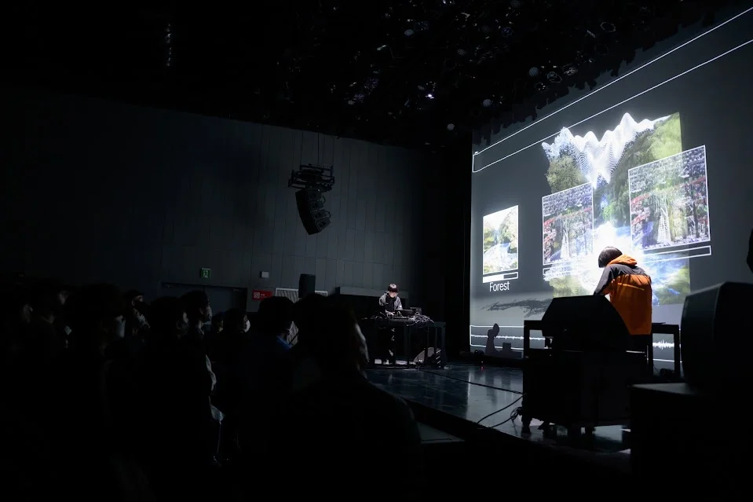

# Afflatus Spectrum

2022, [art work](art%20work--c65f149b664a2d0cef9d8059ce89155c.md)

[https://youtu.be/6_V1suMsUAY](https://youtu.be/6_V1suMsUAY)
## Caption
「Afflatus Spectrum」は人間と人工知能によるオーディオ・ヴィジュアルパフォーマンスである。
人間は音を、人工知能は映像をそれぞれ演奏する。人工知能は、ヴィジュアルノーテーションという音を表現した映像をリアルタイムに生成する。人間は、生成されたヴィジュアルノーテーションを解釈し、音を演奏する。その音を人工知能にフィードバックし、新たなヴィジュアル・ノーテーションを生成する。これを繰り返すことで人間と人工知能が創造的なひらめき（Afflatus）を与え合う創発的なパフォーマンスを形成する。このパフォーマンスの創造性の主体が人間なのかそれとも人工知能なのかを曖昧にして、両者の共創のひとつの形を提示することを目指す。

## Credit
- Santa Naruse
  - Visual/AI Artist
- Reo Anzai
  - Sound Artist

## Exhibition/Events
- [MUTEK.JP 2022 Edition 7](https://tokyo.mutek.org/jp/artists/reo-anzai-santa-naruse)
