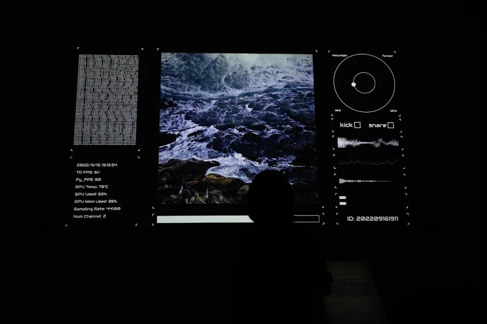
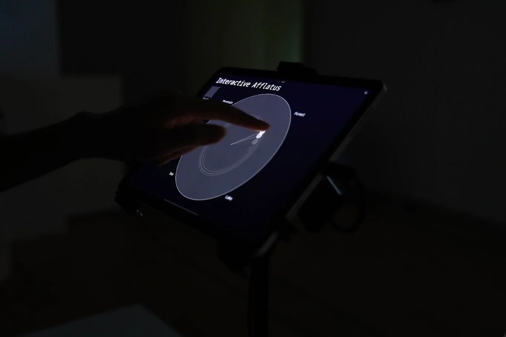

# Interactive Afflatus

2023-2022, [art work](art%20work--c65f149b664a2d0cef9d8059ce89155c.md)

 

[https://youtu.be/_d14j_Fryfg](https://youtu.be/_d14j_Fryfg)

## Caption
《Interactive Afflatus》は、人間と人工知能によるオーディオ／ヴィジュアルパフォーマンス作品である。
人間は音を、人工知能は映像をそれぞれ演奏する。人工知能は、ヴィジュアル・ノーテーションという音を表現した映像をリアルタイムに生成する。人間は、生成されたヴィジュアル・ノーテーションを解釈し、音を実際に演奏する。その音を人工知能にフィードバックし、新たなヴィジュアル・ノーテーションを生成する。これを繰り返すことで人間と人工知能が創造的なひらめき（Afflatus）を与え合う創発的なパフォーマンスを形成する。このパフォーマンスの創造性の主体が人間なのかそれとも人工知能なのかを曖昧にして、両者の共創のひとつの形を提示する。

## Credit
- Santa Naruse
- Thanks
  - Nao Tokui (Technical Advice)
  - Ayaka Sakakibara (Cast/Video Edit)
  - NTT InterCommunication Center
  - Keio University SFC Computational Creativity Lab

## Award
- NeurIPS 2022 Machine Learning for Creativity and Design」Artwork Spotlights 採択
- ISCA INTERNATIONAL STUDENTS CREATIVE AWARD 2023 デジタルコンテンツ部門 入選

## Exhibition/Events
- [INTERNATIONAL STUDENTS CREATIVE AWARD 2023](https://kc-i.jp/activity/award/isca/2023/)
- [ICC アニュアル 2022 生命的なものたち](https://www.ntticc.or.jp/ja/exhibitions/2022/tokui-nao-computational-creativity-lab-keio-university/)
