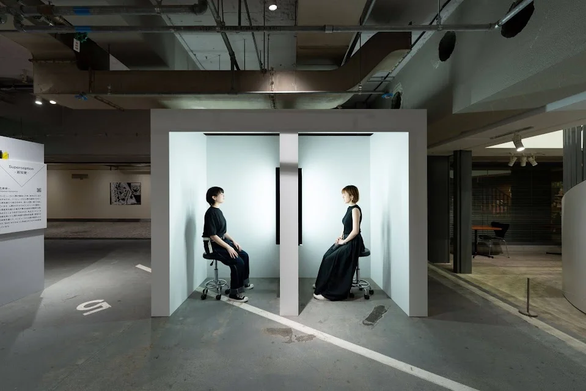

# Morphing Identity

2023-2022, [client work](client%20work--82200cd4d093785cb17be704505c73f9.md)

[https://youtu.be/ahKxwaJ3k_U](https://youtu.be/ahKxwaJ3k_U)

## Caption
私たちのアイデンティティとは何か。本作品は、自分の顔だと分かっている筈なのに、自分だった顔がいつの間にか他者の顔に変容していく体験を提供する。人間の変化知覚特性に基づいて、計算的に作り出された知覚的に滑らかな変化を顔映像に適応して、リアルタイムに自他の比率を徐々に変えながら顔映像を再合成することで、変化を知覚しない顔画像の変化を引き起こす。映像を介したコミュニケーションにおいて、個人を識別するための顔映像が持つアイデンティティの流動性に着目し、自分自身が思う自分と、他者が思う自分がどのように変容し得るかを探索する体験型の作品である。

We explored continuous changes in self-other identity by designing an interpersonal facial morphing experience where the facial images of two users are blended and then swapped over time. Both users’ facial images are displayed side by side, with each user controlling their own morphing facial images, allowing us to create and investigate a multifaceted interpersonal experience. To explore this with diverse social relationships, we conducted qualitative and quantitative investigations through public exhibitions. We found that there is a window of self-identification as well as a variety of interpersonal experiences in the facial morphing process. From these insights, we synthesized a Self-Other Continuum represented by a sense of agency and facial identity. This continuum has implications in terms of the social and subjective aspects of interpersonal communication, which enables further scenario design and could complement findings from research on interactive devices for remote communication.
[https://shunichikasahara.com/portfolio/morphing-identity/](https://shunichikasahara.com/portfolio/morphing-identity/)

## Credit
Concept and Research
- Shunichi Kasahara (Sony CSL)

System
- Shunichi Kasahara (Sony CSL)
- Kye Shimizu (Sony CSL)
- Santa Naruse (Sony CSL)
- Naoto Ienaga (Tsukuba University)

Technical Assistant
- Kazuma Takada (Sony CSL)
- Taku Tanichi (Sony CSL)
- Maki Sugimoto (Keio University)

## Exhibition/Events
- [きみとロボット ニンゲンッテ、ナンダ？](https://www.miraikan.jst.go.jp/exhibitions/spexhibition/kimirobo.html)
- [CHI2023](https://dl.acm.org/doi/abs/10.1145/3544548.3580853)
